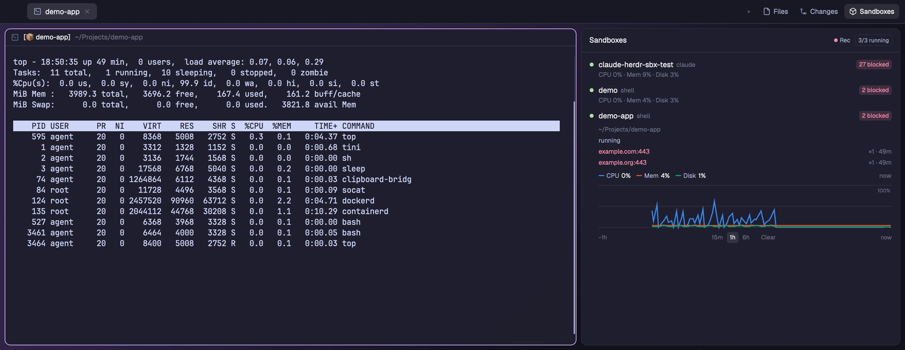
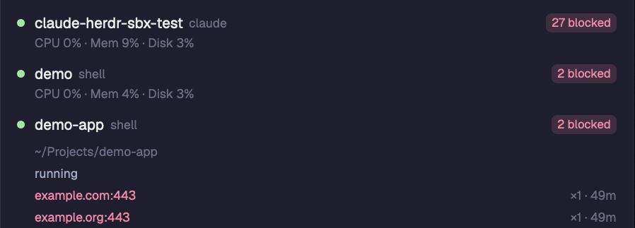
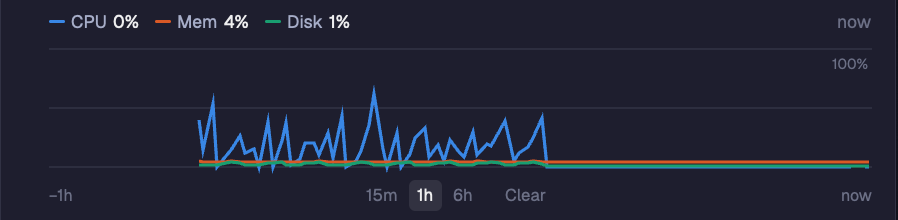

<p align="center">
  
</p>

<h1 align="center">Docker Sandboxes for Herdr</h1>

<p align="center"><strong>Your agent runs in a Docker Sandbox. See what the sandbox is doing, and what it blocked, right next to it.</strong></p>

<p align="center">
  <a href="https://herdr.dev/mods"></a>
  
  
  <a href="LICENSE"></a>
</p>

<p align="center">
  <a href="#install">Install</a> · <a href="#blocked-requests">Blocked requests</a> · <a href="#usage-over-time">Usage over time</a> · <a href="#what-it-runs">What it runs</a> · <a href="RECIPE.md">Recipe</a>
</p>

<br>

An agent's `npm install` hangs inside its sandbox. Is it the network policy? Is the VM out of memory? Normally you'd leave Herdr for `sbx policy log` and `sbx exec`. This panel puts the answer beside your agents:

- **Every sandbox** on this computer, running or stopped, with its agent.
- **Blocked requests:** which hosts the sandbox policy blocked, how often and when.
- **Health:** CPU, memory and disk of each running sandbox.
- **Usage over time:** CPU, memory and disk as lines, over the last 15 minutes, hour or 6 hours.

It opens from a **Sandboxes** button next to Files and Changes.

> [!TIP]
> **Agents in sandboxes already work in Herdr.** Run `sbx run claude <folder>` in a Herdr tab and Herdr tracks it like any other agent: working and done status, the agents list, notifications and the conversation title. This mod adds what Herdr can't see: the sandbox around the agent.

## Install

Ask the agent in your Herdr window:

```text
Read ~/.config/herdr-app/AGENTS.md, then add this mod: https://github.com/mattbv/herdr-sandboxes
```

It reads [RECIPE.md](RECIPE.md) and the files, tells you what the mod runs, copies `mods/sandboxes/` and adds the Sandboxes button next to Files and Changes. Say "in the sidebar" if you want it under the Agents list instead.

You need [Docker Sandboxes](https://docs.docker.com/ai/sandboxes/) (`sbx`) installed and signed in.

<details>
<summary>Install by hand</summary>

Copy the mod (its `mod.json` keeps Herdr from docking it on its own):

```sh
git clone https://github.com/mattbv/herdr-sandboxes.git
cp -R herdr-sandboxes/mods/sandboxes ~/.config/herdr-app/mods/
herdr-app check ~/.config/herdr-app/mods/sandboxes
```

Then put it in a layout of your own. Herdr's shipped layouts are read-only, so clone one first: `herdr-app do layout.clone '{"name":"main","as":"my-layout"}'`.

**As a side panel, next to Files and Changes.** Add a block to the `panel-body` stack:

```json
{ "id": "sandboxes", "type": "block", "content": { "mod": "sandboxes" } }
```

Herdr's tab bar (the shipped `tabs` mod) draws only the Files and Changes buttons. For a Sandboxes button, clone it and point your layout's `tabs` block at the clone:

```sh
herdr-app do mod.clone '{"name":"tabs","as":"tabs-panels"}'
```

In `~/.config/herdr-app/mods/tabs-panels/main.js`:

```js
// 1. Replace the `enabled` line:
const extra = find(root, "sandboxes") ? ["sandboxes"] : [];
const enabled = [...(shared("workspace.panels") ?? ["files", "changes"]), ...extra];

// 2. After the Changes button:
.when(enabled.includes("sandboxes"), el => el.child(panelButton("sandboxes", "Sandboxes", "mods/sandboxes/box.svg")))
```

A cloned mod does not get Herdr's updates to the tab bar. Clone it again after an update if you want them.

**In the sidebar, under Agents.** Add a block to the `sidebar-lists` column. `"sidebar": true` gives it the look of the Agents list:

```json
{ "id": "sandboxes", "type": "block", "content": { "mod": "sandboxes", "props": { "sidebar": true } }, "size": { "weight": 0.6 }, "min": 80 }
```

</details>

## Blocked requests

<p align="center">
  
</p>

- A red **N blocked** badge on any sandbox whose policy blocked network requests.
- **Click a row** for its workspace folder and the blocked hosts, newest first, with how often and how long ago.
- When there's nothing to show, it says why: no sandboxes, the `sbx` daemon is off, `sbx` isn't installed, or `sbx`'s own error (like "not signed in to Docker").

## Usage over time

<p align="center">
  
</p>

- CPU, memory and disk on one 0–100% chart, over **15m, 1h or 6h**. Hover for the values at a moment.
- Readings are kept for 6 hours, across restarts, in the mod's own storage (`~/.config/herdr-app/data/sandboxes/store.json`). They never leave your machine.
- Recording goes on while the panel is closed. **Rec** in the header pauses it; **Clear** under a chart forgets that sandbox.
- The line colors were checked for color-vision deficiency on light and dark themes, and the legend always shows each value as text.

## What it runs

Every 10 seconds, read-only:

- `sbx daemon status`: if the daemon is off, the mod stops here. It never starts the daemon.
- `sbx ls --json`: the sandboxes.
- `sbx policy log --json`: blocked network requests.
- Every 15 seconds, in each running sandbox: `sbx exec <name> sh -c '…'`, which reads `/proc/stat`, `/proc/meminfo`, `df` and `nproc`.

It never creates, stops, removes or changes a sandbox or its policy, and it makes no network requests of its own.

Tested with `sbx` 0.47.0 and the Herdr desktop app 0.1.15 on macOS (Apple silicon).

## Credits

The box icon is [Lucide](https://lucide.dev)'s `box` (ISC).

## License

[MIT](LICENSE)
