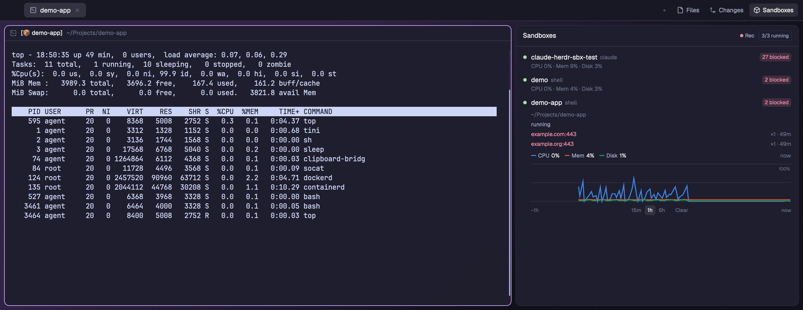

# Docker Sandboxes

A side panel next to Files and Changes that lists every Docker Sandbox (`sbx`) on this computer: whether it runs, its CPU, memory and disk, the network requests its policy blocked, and a chart of its usage over the last 15 minutes, hour or 6 hours. Agents run in a sandbox (`sbx run claude <folder>`) already show in Herdr as agents; this panel shows the sandbox around them.

## What you see

- **The panel**, in the layout's `panel-body` stack: a card with 10px corners, `background` fill, a 1px `border` and the 13px UI font, like Files and Changes.
- **Header**, 42px, 14px side padding, a 1px `border` below:
  - "Sandboxes" in semibold `foreground`.
  - Right side: **Rec**, a 6px dot (`blocked` while recording, `dim` when paused) and the word "Rec" or "Paused" in 10.5px `muted` / `dim`.
  - Then a pill, 10px `muted` text in a 1px `border` box with 4px corners: "2/3 running".
- **One row per sandbox** in the order `sbx ls` gives them, 30px, 8px side padding, 8px corners, `hover` on hover:
  - a 7px status dot: `ansi2` running, `dim` stopped, `ansi3` anything else
  - the name (`foreground` when running, `muted` otherwise), then the agent in 11px `dim`
  - on the right, when the policy blocked requests: a 17px pill, `blocked` text on `blocked` at 15% opacity, "24 blocked" (the sum of the hits).
- **Under a running row** that is closed, 11px `dim`: `CPU 12% · Mem 34% · Disk 2%` (a dash until there is a value). An open row shows the chart's legend instead.
- **An expanded row**, indented 24px, 11px `dim`:
  - the first workspace folder, `~` for the home folder
  - the status word in `muted`
  - "No blocked requests", or up to 8 blocked hosts newest first (host in `blocked`, then `×3 · 5m`), then "+N more"
  - the usage chart (below).
- **The usage chart**, under the blocked hosts:
  - A legend row: for each of CPU, Mem, Disk a 10×2px line in its color, the name in `muted`, the value in `foreground`. Right side: "now", or "5m ago" while hovering.
  - The plot, full width, 76px high: 1px `border` gridlines at 0, 50 and 100%, "100%" in 9px `dim` at the top right, and three 2px lines on one 0–100% axis. Colors: blue `#3987e5`, orange `#d95926`, aqua `#199e70` on a dark theme; `#2a78d6`, `#eb6834`, `#1baf7a` on a light one (checked for color-vision deficiency on both; the legend always carries the values as text).
  - Under it in 10px `dim`: "−1h" on the left, the range buttons `15m · 1h · 6h` and "Clear" in the middle (the chosen range on `raised`), "now" on the right.
  - "Collecting usage… the chart starts after a few readings." until there are two readings; "Recording is off…" when paused.
- **Empty states**, 12px `dim` under the header: "No sandboxes. Start one with sbx run claude.", "The sbx daemon is off. Sandboxes show up here while it runs.", "sbx is not installed.", or the first lines of `sbx`'s own error in `blocked` (for example "not signed in to Docker").
- **The Sandboxes button** in the tab bar, after Files and Changes: 26px, a 14px box icon and "Sandboxes", `selected` while its panel is open.

## How it behaves

- Every 10 seconds it reads the sandboxes and the policy log. Every 15 seconds it takes a health reading in each running sandbox.
- CPU is the share of all the sandbox's CPUs that was busy between two readings, so it shows a dash until the second reading. Memory is `1 − MemAvailable / MemTotal`. Disk is the use of `/home/agent`.
- Clicking a row opens or closes it. Open rows are remembered across restarts.
- While Rec is on (the default), each health reading is stored with its time for 6 hours, also across restarts. Recording goes on while the panel is closed, as long as the layout holding it is shown. Clicking Rec pauses or resumes. Clear forgets that sandbox's history.
- The chart always spans the chosen range up to now. Readings are averaged into at most 120 points. A silence longer than 45 seconds (or 2.5 averaging steps) breaks the line, so a stopped sandbox shows a gap.
- Hovering the plot: 60 invisible columns across it. The hovered one draws a 1px `muted` vertical line at the nearest reading, and the legend shows that reading's values and age.
- If the `sbx` daemon is not running, the panel says so and runs nothing else: it never starts the daemon.
- The panel never changes a sandbox: no create, stop, remove or policy change.

## Built from

- **`mods/sandboxes/`**, `mod.json` `{ "place": "none" }` (the layout places it):
  - `main.js`: the view. `exec` from `herdr` runs:
    - `sbx daemon status` (stop unless it prints `Status: running`)
    - `sbx ls --json` → `{ sandboxes: [{ name, agent, status, workspaces, … }] }`
    - `sbx policy log --json` → `{ blocked_hosts: [{ host, vm_name, count_since, last_seen, reason }], allowed_hosts }`
    - for each running sandbox: `sbx exec <name> sh -c 'cat /proc/stat | head -1; cat /proc/meminfo | head -3; df -P -k /home/agent | tail -1; nproc'`
  - `box.svg`: Lucide's `box` (ISC), the tab bar icon.
  - Charts: `window.paint_path(PathBuilder.stroke(2)….build(), color)`, sized with `.absolute().top(0).left(0).size_full()` inside a relative 76px box.
  - Storage: `localStorage` keys `history` (`{ name: [[ms, cpu, mem, disk], …] }`), `record`, `range`, `open`.
  - `theme()` for every color but the three series; `settings().dark` picks the series' light or dark step; `props().sidebar` gives the sidebar look below.
- **The layout**: `{ "id": "sandboxes", "type": "block", "content": { "mod": "sandboxes" } }` as a child of the `panel-body` stack.
- **The tab bar button**: Herdr's shipped `tabs` mod draws only Files and Changes. Clone it (`mod.clone {name: "tabs", as: "tabs-panels"}`), point the layout's `tabs` block at the clone, and in its `main.js`:
  - after `find(root, "panel")`: `const extra = find(root, "sandboxes") ? ["sandboxes"] : [];` and add `...extra` to `enabled`
  - after the Changes button: `.when(enabled.includes("sandboxes"), el => el.child(panelButton("sandboxes", "Sandboxes", "mods/sandboxes/box.svg")))`
- **Sidebar instead** (optional): a block in `sidebar-lists` with `"props": { "sidebar": true }`, `"size": { "weight": 0.6 }`, `"min": 80`. Then the header is the Agents list's (41px, 11.5px `dim` "Sandboxes", the count as plain text) on `chrome` with a top `border`, and there is no card.

## Watch out

- Write `mod.json` before `main.js`. A mod folder that Herdr sees without a `place` gets docked as a 320px panel on the right, and since this block's `place` is `none`, nothing else would put it there.
- `sbx ls --json` can print an update box after the JSON: read only the first JSON object.
- `sbx exec` can print `WARN:` lines on stderr: read stdout only.
- `paint_path` percentages follow the painted width but not its height: give x as a percentage and y in pixels. A `paint_path` wrapped in a sized `div` paints with no height; size the path element itself.
- `sbx ls` starts the daemon. Check `sbx daemon status` first, or the panel keeps the daemon running.
- An expired Docker sign-in makes `ls` and `policy log` exit 1 with "not signed in to Docker" on stderr: show it, don't crash.
- Blocked counts are `sbx`'s own `count_since`, not a total since the sandbox started.
- A health reading runs a program in each running sandbox (about 0.7s each). They run in parallel, at most every 15 seconds.
- A cloned `tabs` mod does not get Herdr's updates to the tab bar.

## Done when

- With no sandboxes, the panel says "No sandboxes. Start one with sbx run claude."
- `sbx run --detached --name t shell <empty folder>`: within 10 seconds a row "t · shell" with a green dot appears and the pill reads "1/1 running"; within about 30 seconds the `CPU · Mem · Disk` line shows numbers.
- `sbx exec t sh -c 'curl -s https://example.org'`: the row gets a "1 blocked" pill, and its open view lists `example.org:443`.
- After a few minutes with Rec on, the open row's chart draws three lines, and hovering moves a line and changes the legend to that moment.
- Clicking Rec shows "Paused" and the stored history stops growing; clicking it again resumes.
- `sbx daemon stop`: the panel says the daemon is off, and no further `sbx` command runs until it is started again.
- The Sandboxes button opens and closes the panel and is highlighted while it shows.
